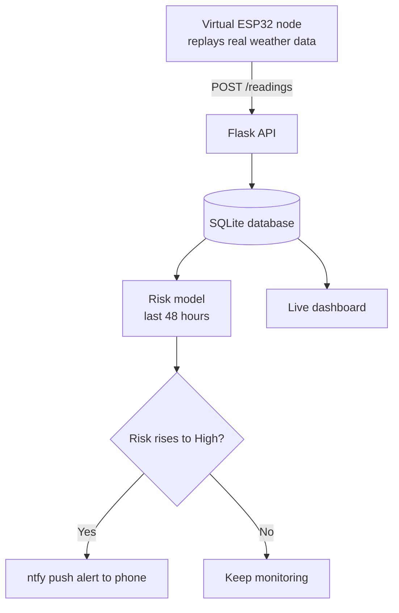

# Arecanut Koleroga Early-Warning System

An IoT system that watches weather conditions in an arecanut plantation, scores the risk of Koleroga (fruit rot) disease over the last 48 hours, and sends a phone alert when the risk rises to High.

Built for Sullya, Karnataka. The sensor node is **simulated**: it replays real hourly weather data, and the plan is to replace it with an ESP32 (see Roadmap).

## Problem

Koleroga causes heavy crop loss for arecanut farmers during the monsoon. Farmers usually spray after the disease has already appeared. This project aims to warn them earlier, so they can act before it spreads.

## Features

- Virtual sensor node posts temperature, humidity and rain readings to a REST API
- Flask API stores readings in SQLite, ignores duplicate readings, and calculates the current risk
- Risk model: Low, Medium or High from rain hours, hours at 95%+ humidity, and total rain in the last 48 hours
- Phone alert through ntfy.sh, sent once when the risk rises to High (not on every High reading)
- Live web dashboard with a risk badge and charts
- Backtest of the model on the 2026 monsoon (June to September)

## Architecture



## Dashboard


## How the risk model works

The model looks at the last 48 hours and gives 0 to 2 points for each of three factors:

| Factor | 1 point | 2 points |
|---|---|---|
| Hours with rain (0.2 mm or more) | 27 | 37 |
| Hours at 95% or higher humidity | 32 | 36 |
| Total rain (mm) | 31 | 52 |

A total of 5 or 6 is **High**, 3 or 4 is **Medium**, and below 3 is **Low**. An alert is sent only when the level rises to High.

## Backtest results (monsoon 2026, Sullya)

I ran the model on every day from 3 June to 30 September 2026 (120 days).

- **First version** (wet hours at 90%+ humidity or any rain, plus a temperature rule): High on 74 of 120 days (62%). That would cause alert fatigue.
- **Why:** the "wet hours" and temperature rules were saturated in Sullya's monsoon, so they added no information.
- **Retuned version:** thresholds set from the percentiles of the monsoon data, with alerts only when risk rises to High.
- **Result:** High on 31 days (26%), Medium on 22, Low on 67, and **9 alerts** in 120 days.


## Limitations

- The sensor node is simulated. It replays real hourly weather from Open-Meteo, not readings from a device in a plantation.
- The thresholds come from weather percentiles, not from recorded Koleroga outbreaks. The backtest shows the model reacts sensibly to real weather, not that it predicts outbreaks.
- Field validation with farmers or a local Krishi Vigyan Kendra (KVK) is still pending. Alerts do not give spraying advice.
- The ntfy topic is a shared-secret name on a public server. It is fine for a demo, not for a production deployment.

## Run it locally

```
git clone https://github.com/kirthana739/arecanut-koleroga-early-warning.git
cd arecanut-koleroga-early-warning/backend
python -m venv venv
venv\Scripts\Activate.ps1
pip install -r requirements.txt
```

Create `backend/.env` with a private topic name, and subscribe to the same topic in the ntfy app:

```
NTFY_TOPIC=your-long-random-topic-name
```

Start the API, then replay a High-risk period from a second terminal:

```
python app.py
python simulate_device.py --end 2026-07-02
```

Open http://127.0.0.1:5000/dashboard to see the live dashboard. To get the alert again, stop the server, delete `readings.db` and start again, because the server only alerts when risk rises to High.

To regenerate the backtest chart: `python backtest.py`

## Project structure

```
backend/     Flask API, risk model, alerts, simulator, backtest
dashboard/   Live dashboard page
docs/        Charts, screenshots, research notes, parts list
firmware/    Reserved for the ESP32 code
ml-model/    Reserved for future image-based detection
```

## Tech stack

Python, Flask, SQLite, pandas, matplotlib, Chart.js, ntfy.sh, Open-Meteo weather data

## Roadmap

- [x] Weather data pipeline (Open-Meteo)
- [x] Risk model and monsoon backtest
- [x] REST API with SQLite storage
- [x] Virtual sensor node
- [x] Phone alerts with ntfy
- [x] Live dashboard
- [ ] Real ESP32 firmware with DHT22 and rain sensor
- [ ] Validate thresholds with local farmers or a KVK
- [ ] Deploy the API to a cloud host
- [ ] Image-based confirmation of Koleroga symptoms