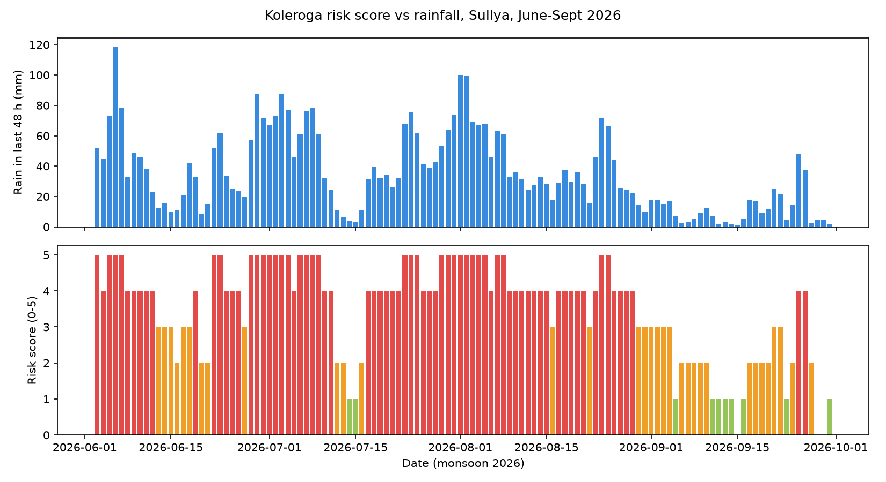

# Arecanut Koleroga Early-Warning System

An IoT system that monitors weather conditions in an arecanut plantation,
predicts the risk of Koleroga (fruit rot) disease, and alerts the farmer
on Telegram before it spreads.

## Problem
Koleroga causes heavy crop loss for arecanut farmers during the monsoon.
Farmers usually spray after the disease has already appeared. This project
aims to warn them 2-3 days earlier.

## Status
- [ ] Hardware setup
- [ ] Sensor data collection
- [ ] Risk prediction
- [ ] Telegram alerts
- [ ] Dashboard
- [ ] Demo video
## Risk model
The model scores the last 48 hours of weather (rain hours, hours at 95%+
humidity, total rainfall) and returns a Low, Medium or High Koleroga risk.

**Backtest on monsoon 2026 (Sullya, Jun-Sep):** the first version marked
62% of days High, which would cause alert fatigue. I retuned the thresholds
from the data and added a rule that alerts only when risk rises to High.
Result: High on 26% of days and 9 alerts in 120 days.

**Limitations:** thresholds are based on weather percentiles, not recorded
outbreak data. Field validation with local farmers / KVK is pending.
